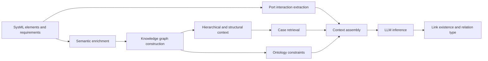

# Multi-Source Context-Enhanced Traceability Prediction for SysML

[](LICENSE)
[](https://www.python.org/)

[中文说明](README_zh-CN.md)

This repository contains the research prototype and experiment artifacts for
predicting traceability links between SysML model elements and requirements.
The framework combines semantic enrichment, graph-derived context, candidate
case retrieval, ontology constraints, and LLM reasoning.

> This is research code. Before publishing a fork, review the data license,
> model licenses, and API-provider terms that apply to your environment.

## Framework

The end-to-end workflow contains the following components:

1. **Semantic enrichment** generates functional descriptions for weakly
   described model elements.
2. **Hierarchical path context** captures the model hierarchy encoded in each
   element's `Path`.
3. **Structural context** retrieves related nodes and subsystem information
   from the SysML knowledge graph.
4. **Interaction context** extracts port, connector, and information-flow
   evidence from XMI fragments.
5. **Case retrieval** scores candidate edges associated with elements similar
   to the current node pair.
6. **Ontology constraints** use SWRL rules to restrict the candidate relation
   space.
7. **LLM inference** predicts link existence and relation type and returns a
   structured JSON result.

The current benchmark primarily evaluates `Refine` and `Satisfy` relations,
while the normalization and reasoning code can be extended with additional
relation aliases and ontology rules.



## Repository Layout

```text
.
|-- main.py                         # End-to-end experiment entry point
|-- config.py                       # Centralized environment-driven settings
|-- construct_json.py               # LLM context construction
|-- call_llm/                       # Single-stage and two-stage LLM calls
|-- enlarge_function/               # Semantic enrichment
|-- kg_retrieve/                    # KG construction and context retrieval
|-- Port_Information/               # XMI port/interaction extraction
|-- protege_reasoner/               # Java/SWRL ontology reasoner
|-- Data/                           # Dataset and split utilities
|-- result_analysis_tools/          # RQ1/RQ2 metric calculator
|-- result/                         # Retained experiment metrics and outputs
|-- scripts/                        # Auxiliary evaluation/document scripts
`-- docs/                           # Configuration and user documentation
```

Generated Java builds, downloaded model weights, local secrets, temporary
results, and very large raw generation logs are excluded through `.gitignore`.

## Installation

### Python

Python 3.12 is recommended. The pinned versions in `requirements.txt` were
exported from the `rag_5060` Conda environment running Python 3.12.13.

```powershell
git clone https://github.com/wumbuk/multi-source-sysml-traceability.git
cd multi-source-sysml-traceability
python -m venv .venv
.\.venv\Scripts\Activate.ps1
python -m pip install --upgrade pip
pip install -r requirements.txt
```

The exported environment uses a CUDA 12.8 nightly PyTorch build. Install a
stable or CPU PyTorch build instead when the target machine does not provide a
compatible NVIDIA CUDA environment.

### Ontology reasoner

The reasoner is a Gradle Java project and targets Java 8-compatible bytecode.
Build the executable fat JAR before running the full pipeline:

```powershell
cd protege_reasoner\kg-reasoner
.\gradlew.bat jar
cd ..\..
```

On Linux or macOS, use `./gradlew jar`.

## Configuration

All machine-specific paths, model identifiers, API endpoints, and credentials
are centralized in [config.py](config.py). Create a private local configuration:

```powershell
Copy-Item .env.example .env
```

Then edit `.env` for your environment. Important variables include:

- `TRACE_EMBEDDING_MODEL`: Hugging Face model ID or local embedding directory.
- `TRACE_EMBEDDING_DEVICE`: `cuda`, `cuda:0`, `cpu`, or empty for automatic
  selection.
- `TRACE_LLM_BASE_URL`: OpenAI-compatible endpoint, including local vLLM.
- `TRACE_LLM_MODEL`: served model identifier.
- `TRACE_LLM_API_KEY`: API key; `EMPTY` is sufficient for many local vLLM
  deployments.
- `TRACE_ENRICHMENT_API_KEY`: optional private key for semantic enrichment.
- `TRACE_REASONER_JAR_PATH`: built Java reasoner JAR.

The committed `.env.example` contains placeholders only. `.env` is ignored by
Git. See [docs/CONFIGURATION.md](docs/CONFIGURATION.md) for all options.

## Running the Pipeline

The default paths target the Air Condition dataset:

```powershell
python main.py
```

The main script reads `KG.csv` and `Judge.csv`, constructs the graph context,
applies ontology reasoning, calls the configured LLM service, and writes the
prediction JSON to `TRACE_OUTPUT_RESULT_PATH`.

Semantic enrichment and dataset splitting are explicit preprocessing steps in
the current experiment script. Their paths are also controlled through
`config.py` and `.env`.

## Evaluation

The metric tool reports:

- **RQ1, Link Existence Prediction:** TP, FP, TN, FN, Accuracy, Precision,
  Recall, and F1.
- **RQ2, Relation Type Prediction:** Oracle Macro-F1/Type Accuracy and pipeline
  Macro-F1/Type Accuracy, with conditional pipeline evaluation by default.
- Error samples: `FP`, `FN`, `Type_Mismatch`, and
  `RQ2_No_Prediction` where applicable.

Example:

```powershell
python result_analysis_tools\analyze_stats.py `
  --gold_csv Data\GenerateContext\Air_Condition\Judge.csv `
  --pred_json result\runs\latest\predictions.json `
  --mode both `
  --rq2_setting both `
  --pipeline_eval conditional `
  --output_metrics result\runs\latest\metrics.json `
  --output_mismatch result\runs\latest\mismatch.json
```

## Data and Reproducibility

- Dataset schema and split notes are documented in [Data/README.md](Data/README.md).
- Result retention rules are documented in [result/README.md](result/README.md).
- Store exact model revisions, vLLM version, GPU/driver information, random
  seeds, and decoding parameters with each reported run.
- Do not commit private datasets, API keys, downloaded weights, or raw
  chain-of-thought generation logs.

## Security

No API credential is required in source code. If a credential has ever been
committed or shared, removing it from the current files is not sufficient:
revoke it at the provider and issue a new key.

## Citation

Formal citation metadata will be added after the corresponding paper metadata
is finalized.

## License

This project is licensed under the [GNU Affero General Public License v3.0](LICENSE)
(`AGPL-3.0`).
