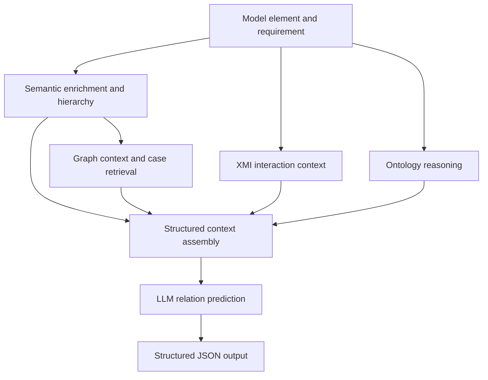

# Multi-Source SysML Traceability

English | [中文](README_zh-CN.md)

Research code and experimental predictions for traceability between requirements and SysML model elements. The task includes predicting whether a traceability link exists and identifying its relation type: `Refine` or `Satisfy`.

This repository provides our multi-source context method, Embedding / Supervised / Direct-LLM baselines, and a LiSSA implementation extended with relation-type prediction for this task.

## Method Overview

The meaning of a SysML model element depends on its name and description, its position in the model hierarchy, its subsystem, and its interactions. Predicting traceability requires combining this information to distinguish semantic association from an actual refinement or satisfaction relation.

Our method takes a model element–requirement pair as input. It organizes element semantics, model context, reference cases, and ontology rules into structured evidence for an LLM to decide whether a relation exists and, if so, select its type. The current experiments focus on `Refine` and `Satisfy`.

### Sources of Context

| Component | Information used | Role in prediction |
|---|---|---|
| Semantic Enrichment | Element names, types, properties, and model paths | Adds functional descriptions that express the semantic role of each model element |
| Hierarchical Path | Model paths of the element and requirement | Identifies their hierarchy and modeling scope to help interpret their meaning |
| Structural Context | Related nodes in the same subsystem in the knowledge graph | Provides the structural surroundings and related functionality of the current element |
| Interaction Context | Ports, connectors, and information flows in XMI | Provides interaction partners and flow directions for port elements |
| Case Retrieval | Similar elements and relation cases in a reference graph | Retrieves and ranks cases with relation types and supporting reasons |
| Ontology Constraint | Element types, properties, and SWRL ontology rules | Infers candidate relations to constrain relation selection |

### Prediction Workflow



1. **Prepare elements and the graph.** Build a knowledge graph from element descriptions and reference relations. If enriched descriptions are already available, use the processed data directly.
2. **Collect evidence.** Retrieve structural context and reference cases for the input pair, infer candidate relations with ontology rules, and add interaction information for port samples.
3. **Assemble context and predict.** Provide the LLM with both elements, reference cases, subsystem nodes, and candidate relations. The default call sequence first produces a relation judgment and then formats that judgment as the required JSON.
4. **Save predictions.** Record the sample ID, relation existence, selected type, explanation, and model-reported confidence.

Standard experiments predict both relation existence and type. Oracle experiments predict only the type for known positive pairs. Six ablation settings control the use of the evidence sources above to examine their contributions. See the [method running guide](src/ours/README.md) for commands.

## Repository Structure

```text
multi-source-sysml-traceability/
├── LICENSE                   # AGPL-3.0 license for the main method
├── README.md                 # English overview
├── README_zh-CN.md           # Chinese overview
├── src/
│   ├── ours/                 # Multi-source context method, ablations, Java reasoner
│   ├── baselines/            # Embedding, Supervised, Direct-LLM
│   └── lissa/                # LiSSA Java implementation, type extension, run scripts
│       └── Data/             # KG.csv, Judge.csv, and other inputs for three datasets
└── results/                  # Experimental predictions
    ├── ours/                 # Qwen3.5-27B / Qwen3.5-9B
    ├── baselines/            # Standard and Oracle experiments
    └── lissa/                # Method / Oracle
```

Implementation entry points and dependencies are under `src`; experimental predictions are under `results`. Each component provides input data in its `Data` directory, with configuration described in its running guide. See [LICENSE](LICENSE) for the main method and [src/lissa/LICENSE](src/lissa/LICENSE) for LiSSA.

## Implementations and Entry Points

| Implementation | Main entry point | Environment and configuration |
|---|---|---|
| Multi-source context method | [`src/ours/main.py`](src/ours/main.py) | Python; `.env`; a separate LLM service; Java ontology reasoner |
| Three baselines | [`src/baselines/run_experiment.py`](src/baselines/run_experiment.py) | Python; `experiment_config.json`; local models or an LLM API |
| LiSSA | [`src/lissa/README.md`](src/lissa/README.md) | Java 21, Maven; embedding and LLM endpoints |

### Clone the Repository

```bash
git clone https://github.com/wumbuk/multi-source-sysml-traceability.git
cd multi-source-sysml-traceability
```

### Multi-Source Context Method

Use a separate Python 3.12 environment. From the repository root, enter the component directory and install dependencies:

```bash
cd src/ours
python -m pip install torch
python -m pip install -r requirements-runtime.txt
```

For initial setup, copy `.env.example` to `.env` and configure data paths, the embedding model, the LLM endpoint, and the model name. Set input paths for the selected dataset under `src/ours/Data` and its corresponding port interaction data.

From `src/ours/protege_reasoner/kg-reasoner`, run:

```bash
./gradlew jar
```

On Windows, use `.\gradlew.bat jar`. The wrapper uses Gradle 8.6; build with a compatible JDK, such as JDK 17. After building the reasoner and configuring models and data, run `python main.py` from `src/ours`.

See the [English running guide](src/ours/README.md) or [Chinese running guide](src/ours/README_zh-CN.md) for full configuration, the complete method, and ablation switches.

### Baselines

From the repository root:

```bash
cd src/baselines
python -m pip install -r requirements.txt
python run_experiment.py --method llm --dataset Air_Condition --dry-run
```

`--dry-run` prints the command without calling a model. Check the inputs in `Data/<dataset>` and configure `experiment_config.json`, then remove this option to run the experiment. Supported methods are `llm`, `embedding`, and `supervised`.

See the [baseline running guide](src/baselines/README.md) for complete commands, Oracle experiments, and model requirements.

### LiSSA

Inputs are under `src/lissa/Data`. Build the Java project from `src/lissa`:

```bash
mvn -DskipTests package
```

Configure the local embedding endpoint and LLM endpoint, then run the generated JAR with `eval -c <configuration-file>`. See the [LiSSA local running guide](src/lissa/README.md) for dataset configuration and complete commands for standard and Oracle experiments.
