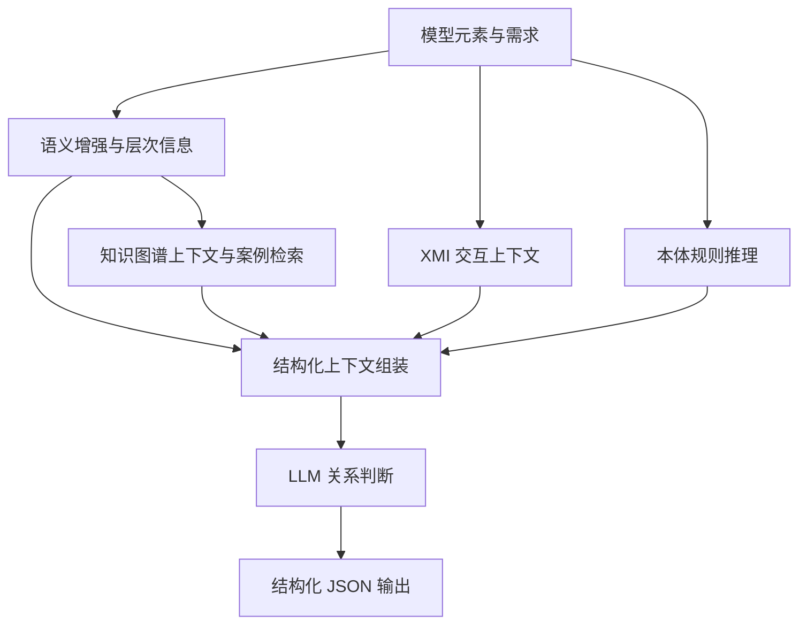

# Multi-Source SysML Traceability

中文 | [English](README.md)

面向需求与 SysML 模型元素的追溯关系预测研究代码与实验预测结果。任务包括判断元素对之间是否存在追溯关系，以及识别 `Refine`、`Satisfy` 关系类型。

本项目提供多源上下文增强方法、Embedding / Supervised / Direct-LLM 基线，以及用于本任务的 LiSSA 类型扩展实现。

## 方法介绍

SysML 模型元素的含义不仅体现在名称和描述中，还与其所在层次、所属子系统及交互方式有关。需求与模型元素之间的追溯判断需要结合这些信息，区分语义上的关联与实际的需求细化或实现关系。

我们的方法以一个“模型元素—需求”对为输入，将元素语义、模型上下文、参考案例和本体规则组织为结构化证据，供大语言模型判断关系是否存在，并在存在关系时选择关系类型。当前实验主要关注 `Refine`（细化需求）和 `Satisfy`（满足需求）。

### 多源上下文

| 组成 | 使用的信息 | 在预测中的作用 |
|---|---|---|
| 语义增强（Semantic Enrichment） | 元素名称、类型、属性及建模路径 | 补充模型元素的功能描述，表达其在系统中的语义角色 |
| 层次路径（Hierarchical Path） | 模型元素与需求的建模路径 | 提供所属层级和建模范围，帮助解释元素含义 |
| 结构上下文（Structural Context） | 知识图谱中同一子系统的相关节点 | 补充当前元素所在的结构环境及相关功能 |
| 交互上下文（Interaction Context） | XMI 中的端口、连接与信息流 | 为端口类元素提供交互对象及流向证据 |
| 案例检索（Case Retrieval） | 参考图谱中的相似元素与关系案例 | 检索并排序相关案例，提供关系类型及成立原因作为参考 |
| 本体约束（Ontology Constraint） | 元素类型、属性及本体中的 SWRL 规则 | 推导候选关系集合，为模型的关系选择提供约束 |

### 预测流程



1. **准备元素与图谱。** 使用元素的语义描述及参考关系构建知识图谱；已有增强描述时，可直接使用处理后的数据。
2. **收集判断证据。** 针对待判断元素对检索结构上下文和参考案例，计算本体候选关系，并为端口类样本补充交互信息。
3. **组装上下文并预测。** 将两侧元素信息、案例、子系统节点和候选关系送入 LLM。默认调用流程先生成关系判断，再将判断整理为规定的 JSON 格式。
4. **保存结果。** 输出样本编号、关系是否存在、选择的关系类型、判断原因及模型给出的置信度。

普通实验同时预测关系存在性与类型；Oracle 实验在已知关系存在的正例上仅预测类型。六种消融设置分别控制上述证据的使用，用于分析各类信息对追溯预测的贡献。具体运行方式见 [方法运行说明](src/ours/README_zh-CN.md)。

## 项目结构

```text
multi-source-sysml-traceability/
├── LICENSE                   # 主方法 AGPL-3.0 许可证
├── README.md                 # 英文说明
├── README_zh-CN.md           # 中文说明
├── src/
│   ├── ours/                 # 多源上下文方法、消融开关、Java 本体推理器
│   ├── baselines/            # Embedding、Supervised、Direct-LLM
│   └── lissa/                # LiSSA Java 实现、类型扩展及运行脚本
│       └── Data/             # 三组数据的 KG.csv、Judge.csv 等输入
└── results/                  # 实验预测结果
    ├── ours/                 # Qwen3.5-27B / Qwen3.5-9B
    ├── baselines/            # 普通实验与 Oracle 结果
    └── lissa/                # Method / Oracle
```

各实现的入口和依赖位于 `src`，实验预测位于 `results`。各组件的 `Data` 目录提供输入数据，配置方法见对应的运行说明。主方法许可证见 [LICENSE](LICENSE)，LiSSA 许可证见 [src/lissa/LICENSE](src/lissa/LICENSE)。

## 实现与运行入口

| 实现 | 主要入口 | 环境与配置 |
|---|---|---|
| 多源上下文方法 | [`src/ours/main.py`](src/ours/main.py) | Python；`.env`；独立的 LLM 服务；Java 本体推理器 |
| 三类基线 | [`src/baselines/run_experiment.py`](src/baselines/run_experiment.py) | Python；`experiment_config.json`；本地模型或 LLM API |
| LiSSA | [`src/lissa/README_zh-CN.md`](src/lissa/README_zh-CN.md) | Java 21、Maven；embedding 与 LLM 接口 |

### 获取项目

```bash
git clone https://github.com/wumbuk/multi-source-sysml-traceability.git
cd multi-source-sysml-traceability
```

### 多源上下文方法

推荐使用独立 Python 3.12 环境。在仓库根目录进入组件目录后安装依赖：

```bash
cd src/ours
python -m pip install torch
python -m pip install -r requirements-runtime.txt
```

首次配置时将 `.env.example` 复制为 `.env`，设置数据路径、embedding 模型、LLM 地址和模型名称。根据 `src/ours/Data` 中的数据集设置输入路径及对应的端口交互数据。

在 `src/ours/protege_reasoner/kg-reasoner` 中运行：

```bash
./gradlew jar
```

Windows 使用 `.\gradlew.bat jar`。包装器使用 Gradle 8.6；以适合该版本的 JDK 构建，例如 JDK 17。构建成功并完成模型与数据配置后，在 `src/ours` 中运行 `python main.py`。

详细配置、完整方法和消融开关见 [英文运行说明](src/ours/README.md) 与 [中文运行说明](src/ours/README_zh-CN.md)。

### 基线方法

在仓库根目录执行：

```bash
cd src/baselines
python -m pip install -r requirements.txt
python run_experiment.py --method llm --dataset Air_Condition --dry-run
```

`--dry-run` 仅生成运行命令，不调用模型。确认 `Data/<dataset>` 输入并完成 `experiment_config.json` 配置后，移除该参数执行实验；`--method` 支持 `llm`、`embedding`、`supervised`。

完整方法、Oracle 实验和模型要求见 [基线运行说明](src/baselines/README_zh-CN.md)。

### LiSSA

输入数据位于 `src/lissa/Data`。在 `src/lissa` 中构建 Java 项目：

```bash
mvn -DskipTests package
```

配置本地 embedding 接口和 LLM 接口后，使用构建得到的 JAR 执行 `eval -c <配置文件>`。数据集配置、普通实验与 Oracle 实验的完整命令见 [LiSSA 本地运行说明](src/lissa/README_zh-CN.md)。
